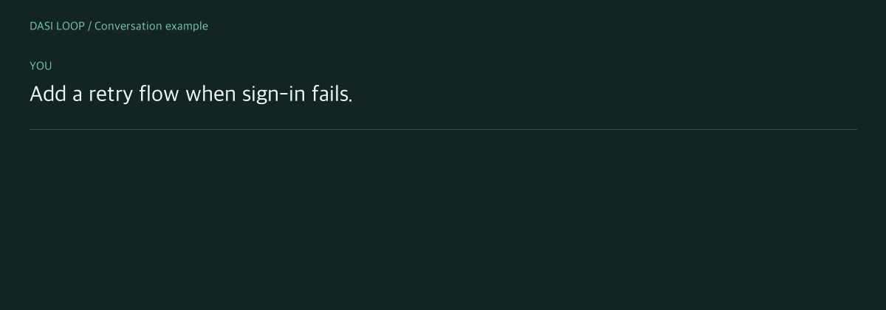

<div align="center">
  <p><a href="README.md">한국어</a> · <strong>English</strong></p>
  <h1>Dasi Loop</h1>
  <h3>Plan it together. Build it better.</h3>
  <p>Codex · Claude Code · Node.js 18+ · MIT</p>
</div>

<p align="center">
  <picture>
    <source media="(prefers-reduced-motion: reduce)" srcset="docs/readme/workflow.en.png" />
    
  </picture><br />
  <sub>An example planning conversation, not a recording of an actual run. · <a href="docs/readme/workflow.en.png">View static image</a></sub>
</p>

[Write a PRD](skills/dasi-loop/references/prd.md) → [Agree with the user](skills/dasi-loop/references/planning.md) → [Build & independently evaluate](skills/dasi-loop/references/evaluation.md) → Improve

<a id="quick-start"></a>

## Get started

Requires Node.js 18+. Independent evaluation needs an authenticated Codex CLI or compatible evaluator. A model and API key are not bundled.

```sh
npm install --global dasi-loop
dasi-loop install --agent codex
```

For Claude Code, install with `--agent claude`. Start a new agent session, then ask:

```text
Use $dasi-loop to implement this feature. Write a PRD and review it with me first.
Agree on scope and completion criteria, then implement, independently evaluate
and improve within three rounds.
```

> [!NOTE]
> Version 0.5.0 adds persistent PRD instructions, automatic user-skill sync, and end-of-run version notices. The lookup is bounded to two seconds; unavailable network checks are silently skipped after the result is saved.

<details>
<summary>Install scope and GitHub version</summary>

**Install only in this project**

```sh
dasi-loop install --agent codex --scope project
```

User installs go to `~/.codex/skills` or `~/.claude/skills`; project installs go to `.agents/skills` or `.claude/skills`.

**Install current main**

```sh
npm install --global git+https://github.com/dev-kicking/Dasi-Loop.git
dasi-loop install --agent codex
```

If the skill is already installed, replace the final `install` with `update`. Existing files are backed up.

</details>

## Updates

Updating the npm package also syncs existing user-level skills when install scripts are allowed. The second command below is the manual fallback if npm skips the script.

```sh
npm install --global dasi-loop@latest
dasi-loop update --agent codex
```

Check the package version with `dasi-loop --version`. Previous skills, including local edits, are preserved in `dasi-loop-backups`. Start a new session after updating.

<details>
<summary>Automatic sync in 0.5.0</summary>

When install scripts are allowed, npm updates also sync existing user-level skills. Approve the script once in npm environments requiring approval:

```sh
npm config set allow-scripts=dasi-loop --location=user
npm update -g dasi-loop
```

After updating the npm package, update project skills from the project root with `dasi-loop update --agent codex --scope project`. Use `--agent claude` for Claude Code. If npm skips scripts, sync user-level skills manually too. For GitHub installs, reinstall from the same GitHub source before syncing.

</details>

<a id="documentation"></a>

## Documentation

| Need | Start here |
| :--- | :--- |
| Setup, scoring and limitations | [Full guide](docs/usage.md) |
| Planning and user agreement | [Planning workflow](skills/dasi-loop/references/planning.md) · [Persistent PRD](skills/dasi-loop/references/prd.md) |
| Independent evaluation and records | [Evaluator](skills/dasi-loop/references/evaluation.md) · [Record helper](skills/dasi-loop/references/records.md) |
| Product requirements | [PRD (한국어)](https://github.com/dev-kicking/Dasi-Loop/blob/main/docs/prd/dasi-loop-updates.md) |
| Translation and design conventions | [Add a language](docs/readme/TRANSLATING.md) · [Color and motion](docs/readme/STYLE.md) |

<details>
<summary>Completion and limitations</summary>

Planning reviews do not assign implementation scores. After agreement, fixed criteria and weights determine implementation scores; a high score cannot override required failures. Missing independent evaluation means review is still needed. Records live in `~/.dasi-loop/runs`. PRD authoring and user discussion are skill instructions; the helper does not enforce document creation itself.

</details>

## Development

```sh
npm test
npm pack --dry-run
```

---

<p align="center">
  Maintainer <a href="https://github.com/dev-kicking">@dev-kicking</a> ·
  <a href="https://github.com/dev-kicking/Dasi-Loop/issues">Report an issue</a> ·
  <a href="https://github.com/dev-kicking/Dasi-Loop/pulls">Suggest an improvement</a> ·
  <a href="LICENSE">MIT License</a>
</p>
