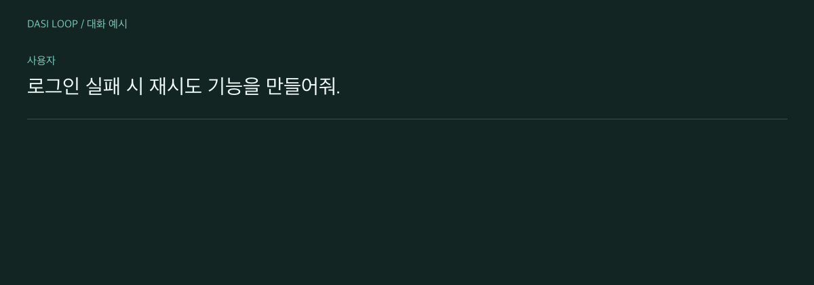

<div align="center">
  <p><strong>한국어</strong> · <a href="README.en.md">English</a></p>
  <h1>Dasi Loop</h1>
  <h3>기획부터 검증까지, 다시 단단하게.</h3>
  <p>Codex · Claude Code · Node.js 18+ · MIT</p>
</div>

<p align="center">
  <picture>
    <source media="(prefers-reduced-motion: reduce)" srcset="docs/readme/workflow.ko.png" />
    
  </picture><br />
  <sub>기획 검토 대화의 예시이며 실제 실행 녹화가 아닙니다. · <a href="docs/readme/workflow.ko.png">정지 이미지 보기</a></sub>
</p>

[PRD 기록](skills/dasi-loop/references/prd.md) → [사용자 합의](skills/dasi-loop/references/planning.md) → [구현·독립 평가](skills/dasi-loop/references/evaluation.md) → 개선

<a id="quick-start"></a>

## 시작하기

Node.js 18+가 필요합니다. 독립 평가에는 인증된 Codex CLI 또는 호환 평가기가 필요하며, 모델이나 API 키는 포함하지 않습니다.

```sh
npm install --global dasi-loop
dasi-loop install --agent codex
```

Claude Code는 `--agent claude`로 설치합니다. 새 에이전트 세션을 열고 요청하세요.

```text
$dasi-loop로 이 기능을 만들어줘. 먼저 PRD를 작성하고 나와 검토해줘.
범위와 완료 기준을 합의한 다음 구현하고, 최대 3회 독립 평가·개선해줘.
```

> [!NOTE]
> 0.5.0부터 PRD 파일 작성 지침, 사용자 공용 스킬 자동 동기화, 종료 시 새 버전 안내를 제공합니다. 버전 조회는 최대 2초이며, 네트워크를 사용할 수 없으면 작업 결과를 저장한 채 조용히 건너뜁니다.

<details>
<summary>설치 범위와 GitHub 버전</summary>

**현재 프로젝트에만 설치**

```sh
dasi-loop install --agent codex --scope project
```

사용자 설치는 `~/.codex/skills` 또는 `~/.claude/skills`, 프로젝트 설치는 `.agents/skills` 또는 `.claude/skills`에 저장합니다.

**현재 main 설치**

```sh
npm install --global git+https://github.com/dev-kicking/Dasi-Loop.git
dasi-loop install --agent codex
```

이미 스킬이 있으면 마지막 명령의 `install`을 `update`로 바꾸세요. 기존 파일은 백업합니다.

</details>

## 업데이트

공개 npm 패키지를 갱신하면, 설치 스크립트가 허용된 환경에서는 기존 사용자 공용 스킬도 함께 갱신됩니다. 아래 두 번째 명령은 스크립트가 차단됐을 때 수동으로 동기화하는 방법입니다.

```sh
npm install --global dasi-loop@latest
dasi-loop update --agent codex
```

`dasi-loop --version`으로 패키지 버전을 확인합니다. 이전 스킬과 사용자 수정은 `dasi-loop-backups`에 보존됩니다. 갱신 후 새 세션을 시작하세요.

<details>
<summary>0.5.0의 자동 동기화</summary>

설치 스크립트 실행이 허용되면 npm 갱신 때 기존 사용자 공용 스킬도 동기화합니다. 스크립트 승인이 필요한 npm 환경에서는 한 번 허용하세요.

```sh
npm config set allow-scripts=dasi-loop --location=user
npm update -g dasi-loop
```

프로젝트 스킬은 npm 패키지 갱신 후 프로젝트 루트에서 `dasi-loop update --agent codex --scope project`를 실행하세요. Claude는 `--agent claude`를 사용합니다. 스크립트가 차단되면 공용 스킬도 수동 `update`가 필요합니다. GitHub 설치본은 같은 GitHub 소스로 다시 설치한 뒤 스킬을 갱신하세요.

</details>

<a id="documentation"></a>

## 문서

| 목적 | 바로가기 |
| :--- | :--- |
| 설치·점수·제한의 상세 설명 | [사용 가이드 (English)](docs/usage.md) |
| 기획·사용자 합의 | [기획 절차 (English)](skills/dasi-loop/references/planning.md) · [PRD 지침 (English)](skills/dasi-loop/references/prd.md) |
| 독립 평가·실행 기록 | [평가기 (English)](skills/dasi-loop/references/evaluation.md) · [기록 도구 (English)](skills/dasi-loop/references/records.md) |
| 현재 제품 요구사항 | [PRD](https://github.com/dev-kicking/Dasi-Loop/blob/main/docs/prd/dasi-loop-updates.md) |
| 번역 추가·디자인 규칙 | [언어 추가 안내](docs/readme/TRANSLATING.md) · [컬러와 모션](docs/readme/STYLE.md) |

<details>
<summary>완료 판정과 한계</summary>

기획 검토에는 구현 점수를 매기지 않습니다. 합의 후 고정한 평가 기준과 가중치로 구현 점수를 계산하며, 높은 점수도 필수 실패를 덮지 못합니다. 독립 평가를 못 하면 검토가 필요하다고 보고합니다. 기록은 `~/.dasi-loop/runs`에 보존합니다. PRD 작성과 사용자 대화는 스킬 지침이며, 파일 생성 자체를 helper가 강제하지는 않습니다.

</details>

## 개발

```sh
npm test
npm pack --dry-run
```

---

<p align="center">
  관리자 <a href="https://github.com/dev-kicking">@dev-kicking</a> ·
  <a href="https://github.com/dev-kicking/Dasi-Loop/issues">문제 제보</a> ·
  <a href="https://github.com/dev-kicking/Dasi-Loop/pulls">개선 제안</a> ·
  <a href="LICENSE">MIT 라이선스</a>
</p>
